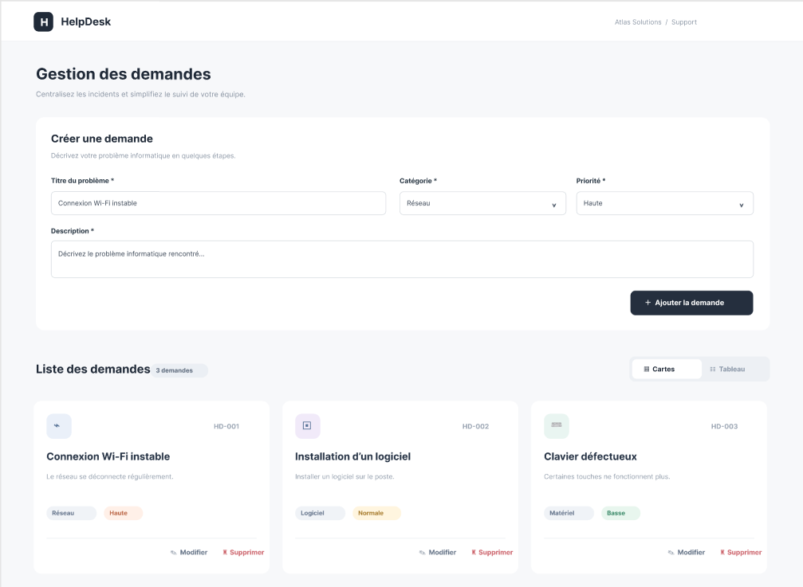

# HelpDesk — Gestion des demandes de support informatique

## Aperçu du projet

HelpDesk est une application web responsive permettant de consulter, d'ajouter et de supprimer des demandes de support informatique à travers une interface simple et interactive.



## Technologies utilisées
- HTML5
- CSS3
- JavaScript Vanilla

## Fonctionnalités
- Affichage dynamique des demandes.
- Ajout de demandes avec validation du formulaire.
- Suppression avec confirmation.
- Compteur dynamique des demandes.
- Gestion des catégories et des priorités.
- Interface responsive.

## Livrables

- **Application en ligne :** [GitHub Pages](https://yassinedzaouha.github.io/HelpDesk/)
- **Planification du projet :** [Tableau Jira](https://yassinedzaouha2.atlassian.net/jira/software/projects/HEL/list?jql=project+%3D+HEL+ORDER+BY+cf%5B10019%5D+ASC&atlOrigin=eyJpIjoiZTY5MzIwMTVmODIzNDc4OWI2NDE5NTg1ZDQ3MmQ3YWIiLCJwIjoiaiJ9)
- **Maquette UI/UX :** [Figma](https://www.figma.com/design/C4paQx4ZCBL7sHSoCtyTx3/HelpDesk-%E2%80%94-Sprint-2-Brief-1-%E2%80%94-Maquettes?node-id=0-1&p=f&t=3Wg7FFXWRu4R8cs9-0)

## Structure du projet
```text
HelpDesk/
├── assets/
│   └── helpdesk-preview.png
├── css/
│   └── style.css
├── js/
│   └── script.js
├── index.html
└── README.md
```

## Installation et lancement

1. Cloner le repository :
   ```bash
   git clone https://github.com/yassinedzaouha/HelpDesk.git
   ```
2. Ouvrir le dossier du projet.
3. Lancer `index.html` dans un navigateur.

## Contexte pédagogique

Projet individuel réalisé dans le cadre de la formation YouCode afin de pratiquer la manipulation du DOM, les événements JavaScript et la validation des formulaires.

**Remarque :** L'application fonctionne entièrement dans le navigateur, sans backend ni base de données.
